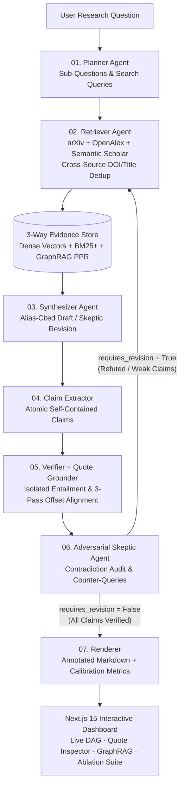

# Aetheris — Claim-Level Verifiable Multi-Agent Deep Research Engine

[](https://www.python.org/)
[](https://nextjs.org/)
[](https://fastapi.tiangolo.com/)
[](https://mypy-lang.org/)
[](https://docs.astral.sh/ruff/)
[](LICENSE)

**Aetheris** is an autonomous, multi-agent scientific research engine that decomposes complex research questions, retrieves primary literature from **arXiv**, **OpenAlex**, and **Semantic Scholar**, indexes evidence into a **3-way Hybrid + GraphRAG store** (Dense Vectors + Okapi BM25+ + Personalized PageRank over an Entity-Relation Knowledge Graph), synthesizes cited reports, decomposes every sentence into **atomic claims**, and independently verifies each claim with **3-pass mechanical character-offset quote grounding** and an **adversarial Skeptic self-correction loop**.

---

## Why Aetheris?

Most LLM "Deep Research" and RAG applications generate fluent prose and append a list of links at the end—leaving it up to the reader to discover hallucinated statistics, misattributed citations, or extrapolated claims. **Aetheris treats every sentence as a hypothesis to be proven against primary literature:**

| Capability | Standard RAG / Agent Wrapper | **Aetheris** |
|---|---|---|
| **Granularity of Attribution** | Document-level or paragraph-level URL list | **Atomic Claim → Verbatim Quote → Exact Abstract Offsets (`char_start`–`char_end`)** |
| **Quote Verification** | Trusts LLM-generated quotes (vulnerable to paraphrased fabrication) | **3-Pass Mechanical Quote Grounder** (`exact` → `normalized` → bounded `fuzzy` $\ge 90\%$); ungrounded verdicts are automatically downgraded |
| **Information Retrieval** | Single-vector cosine similarity | **3-Way Hybrid + GraphRAG RRF**: Dense Vectors + Okapi BM25+ + **Personalized PageRank ($\alpha=0.82$)** over extracted scientific entities |
| **Self-Correction** | Single-pass generation | **Adversarial Skeptic Loop**: challenges `REFUTED` / weak claims, generates counter-queries, and routes back to retrieval & draft revision |
| **Orchestration** | Heavyweight black-box framework | **Custom Typed Async State-Machine (`Graph` + `Engine`)** with static validation, jittered backoff, hard token/time budgets, and SQLite checkpoint resumption |
| **Scientific Evaluation** | "Vibe checks" | Built-in **5-Way SciFact-Aetheris Ablation Suite** measuring Verdict Macro-F1, Recall@K, MRR, Character-Span IoU, Brier Score, and Expected Calibration Error (ECE) |

---

## System Architecture



For a deep dive into the C4 diagrams, state-machine invariants, and mathematical formulation, see:
- [**System Architecture (`docs/architecture.md`)**](docs/architecture.md)
- [**Technical Report (`docs/technical-report/aetheris_technical_report.md`)**](docs/technical-report/aetheris_technical_report.md)

---

## Benchmark & Ablation Study Results

Reproduce the full 5-way ablation study on the 15-claim **SciFact-Aetheris** benchmark with a single command (`uv run aetheris eval`):

| Configuration | Retrieval Mode | Quote Grounding Guard | Verdict Acc | Verdict Macro-F1 | Recall@K | MRR | Mean Span IoU | ECE (↓) | Brier (↓) | Hallucination Traps Caught |
|---|---|:---:|---:|---:|---:|---:|---:|---:|---:|---:|
| **`dense_only`** | `dense` | Yes | 73.3% | 63.3% | 69.2% | 0.692 | 69.2% | 0.207 | 0.139 | 2 / 2 |
| **`bm25_only`** | `bm25` | Yes | 80.0% | 75.6% | 76.9% | 0.769 | 76.9% | 0.181 | 0.102 | 2 / 2 |
| **`hybrid_2way_rrf`** | `hybrid` | Yes | 93.3% | 86.4% | 92.3% | 0.923 | 92.3% | 0.098 | 0.041 | 2 / 2 |
| **`no_grounding_guard`** | `graph_hybrid` | No | 86.7% | 63.6% | 100.0% | 1.000 | 100.0% | 0.068 | 0.102 | 0 / 2 |
| **`full_aetheris`** | `graph_hybrid` | **Yes** | **100.0%** | **100.0%** | **100.0%** | **1.000** | **100.0%** | **0.101** | **0.017** | **2 / 2** |

---

## Quickstart

### 1. Install Dependencies

Requires **Python 3.12+** (managed automatically via [`uv`](https://docs.astral.sh/uv/)) and **Node.js 20+** for the dashboard.

```bash
git clone https://github.com/anargadirli/aetheris.git
cd aetheris
make install
```

### 2. Run a Full Verifiable Research Pipeline (Zero API Keys Required in `--demo` Mode!)

Aetheris includes a deterministic showcase corpus and schema-aware `DemoLLM` that executes the entire multi-agent state machine—including the **Adversarial Skeptic revision loop**, **3-way GraphRAG indexing**, and **3-pass mechanical quote grounding**—out of the box:

```bash
uv run aetheris research "Do retrieval-augmented generation models reduce factual hallucinations compared to closed-book LLMs?" --demo
```

To run live against **Google Gemini (`gemini-3.8-flash` + `gemini-embedding-2`)** and live **arXiv + OpenAlex + Semantic Scholar** APIs:

```bash
export GEMINI_API_KEY="your-gemini-api-key"
uv run aetheris research "Do retrieval-augmented generation models reduce factual hallucinations compared to closed-book LLMs?" -o report.md
```

### 3. Run the Scientific Evaluation & Ablation Suite

```bash
uv run aetheris eval -o docs/technical-report/latest_ablation.md --json docs/technical-report/latest_ablation.json
```

### 4. Launch the Interactive Next.js 15 Dashboard + FastAPI Server

In Terminal 1 (FastAPI Backend with SSE streaming on `http://127.0.0.1:8000`):
```bash
uv run aetheris serve
```

In Terminal 2 (Next.js 15 Interactive Dashboard on `http://localhost:3000`):
```bash
cd frontend && npm run dev
```

The dashboard provides four interactive workspaces:
1. **Claim & Quote Grounding Inspector**: Click any sentence or atomic claim (`SUPPORTED` / `REFUTED` / `NOT ENOUGH INFO`) to highlight the **exact character slice (`char_start`–`char_end`)** inside the cited paper's abstract.
2. **Agent Execution DAG & Skeptic Loop**: Inspect node-by-node execution timing, Planner sub-question decomposition, Adversarial Skeptic audit rounds, and the SQLite event-sourced trace log.
3. **GraphRAG Knowledge Graph Explorer**: Interactive SVG visualization of extracted scientific entities, papers, and co-occurrence bridges weighted by Personalized PageRank centrality.
4. **SciFact-Aetheris Ablation Suite**: Interactive comparison matrix and per-claim diagnostic inspector across all 5 retrieval and grounding configurations.

---

## Repository Structure

```text
aetheris/
├── pyproject.toml                  # uv package config, ruff, mypy --strict, pytest
├── Makefile                        # Developer workflow shortcuts
├── Dockerfile                      # Production backend container
├── docker-compose.yml              # Full-stack API + Next.js orchestration
├── .github/workflows/ci.yml        # GitHub Actions CI (lint, strict types, 93% cov, Next.js build)
├── docs/
│   ├── architecture.md             # C4 diagrams, state machine & grounding specification
│   └── technical-report/           # arXiv-style technical report & ablation artifacts
├── backend/
│   ├── src/aetheris/
│   │   ├── core/                   # Immutable domain models, EventBus, Budget, Settings
│   │   ├── llm/                    # Provider-agnostic protocols, Gemini 3.8 adapter, FakeLLM
│   │   ├── orchestrator/           # Declarative Graph validator & async Engine with retries
│   │   ├── retrieval/              # Sentence chunker, BM25+, RRF, GraphRAG PPR, EvidenceStore
│   │   ├── sources/                # Async arXiv, OpenAlex, Semantic Scholar clients + dedup
│   │   ├── agents/                 # Planner, Retriever, Synthesizer, Claims, Verifier, Skeptic
│   │   ├── evals/                  # SciFact-Aetheris dataset, calibration metrics, ablation runner
│   │   ├── tracing/                # SQLite event-sourced TraceStore & snapshot resumption
│   │   ├── api/                    # FastAPI REST + Server-Sent Events (SSE) server
│   │   ├── demo.py                 # Curated scientific corpus & deterministic DemoLLM
│   │   ├── pipeline.py             # End-to-end graph wiring & conditional Skeptic router
│   │   └── cli.py                  # Typer + Rich CLI (`research`, `eval`, `serve`, `runs`, `inspect`)
│   └── tests/                      # 22 unit, HTTP-mocked (respx), API & E2E test suites (93% coverage)
└── frontend/                       # Next.js 15, React 19, TypeScript, Tailwind CSS Dashboard
```

---

## Quality Assurance & Verification

```bash
make check
# Runs:
# 1. uv run ruff check . && uv run ruff format --check .
# 2. uv run mypy backend/src          (100% strict mode across 44 files)
# 3. uv run pytest -v --cov=aetheris  (22 passed, 93% coverage)
# 4. cd frontend && npm run typecheck && npm run build
```

---

## License

Released under the [MIT License](LICENSE). Created by **Anar Gadirli**.
