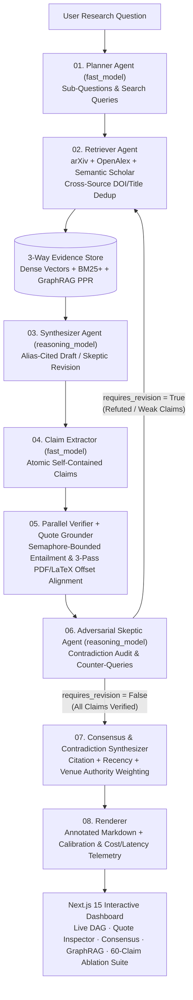

# Aetheris — Claim-Level Verifiable Multi-Agent Deep Research Engine

[](https://www.python.org/)
[](https://nextjs.org/)
[](https://fastapi.tiangolo.com/)
[](https://mypy-lang.org/)
[](https://docs.astral.sh/ruff/)
[](LICENSE)

**Aetheris** is an autonomous, multi-agent scientific research engine that decomposes complex research questions, retrieves primary literature from **arXiv**, **OpenAlex**, and **Semantic Scholar**, indexes evidence into a **3-way Hybrid + GraphRAG store** (Dense Vectors + Okapi BM25+ + Personalized PageRank over an Entity-Relation Knowledge Graph), synthesizes cited reports, decomposes every sentence into **atomic claims**, independently verifies each claim in parallel with **3-pass mechanical character-offset quote grounding** (resilient to multi-column PDF hyphenation, LaTeX math, and inline citation markers), resolves cross-paper contradictions via an **authority-weighted Scientific Consensus & Contradiction Synthesizer**, and executes an **adversarial Skeptic self-correction loop**.

---

## Why Aetheris?

Most LLM "Deep Research" and RAG applications generate fluent prose and append a list of links at the end—leaving it up to the reader to discover hallucinated statistics, misattributed citations, or extrapolated claims. **Aetheris treats every sentence as a hypothesis to be proven against primary literature:**

| Capability | Standard RAG / Agent Wrapper | **Aetheris** |
|---|---|---|
| **Granularity of Attribution** | Document-level or paragraph-level URL list | **Atomic Claim → Verbatim Quote → Exact Abstract Offsets (`char_start`–`char_end`)** |
| **Quote Verification & Noisy PDF Grounding** | Trusts LLM-generated quotes (vulnerable to paraphrased fabrication) | **3-Pass Mechanical Quote Grounder** (`exact` → PDF/LaTeX-aware `normalized` → bounded `fuzzy` $\ge 90\%$); ungrounded verdicts are automatically downgraded |
| **Information Retrieval** | Single-vector cosine similarity | **3-Way Hybrid + GraphRAG RRF**: Dense Vectors + Okapi BM25+ + **Personalized PageRank ($\alpha=0.82$)** over extracted scientific entities |
| **Scientific Disagreement & Consensus** | Overwrites conflicting claims or averages viewpoints | **Contradiction Synthesizer (`agents/contradiction.py`)**: weighs competing papers by **Citation Count, Recency ($\Delta t$), and Venue Tier** ($W(p) = 0.45 S_{\text{cite}} + 0.30 S_{\text{rec}} + 0.25 S_{\text{venue}}$) |
| **Self-Correction & Parallelism** | Single-pass sequential generation | **Bounded Concurrent Claim Verification** (`asyncio.Semaphore` + Token-Bucket Rate Limiter) + **Adversarial Skeptic Loop** |
| **Orchestration & Deterministic Replay** | Heavyweight black-box framework | **Custom Typed Async State-Machine (`Graph` + `Engine`)** with **Tiered Model Routing** (`fast_model` vs `reasoning_model`), `p50`/`p95`/`p99` latency tracking, SQLite WAL persistence, and **`aetheris replay <run_id> --from-node <node>`** |
| **Scientific Evaluation** | "Vibe checks" or tiny synthetic toy fixtures | **60-Claim Adversarial SciFact-Aetheris Benchmark** with **95% Bootstrap CIs (1,000 resamples)**, **3×3 Confusion Matrix**, and a **6-Category Error Taxonomy** |

---

## System Architecture



For a deep dive into the C4 diagrams, state-machine invariants, and mathematical formulation, see:
- [**System Architecture (`docs/architecture.md`)**](docs/architecture.md)
- [**Technical Report (`docs/technical-report/aetheris_technical_report.md`)**](docs/technical-report/aetheris_technical_report.md)

---

## Benchmark & Ablation Study Results (N = 60 Adversarial Claims)

Reproduce the full 5-way ablation study on the 60-claim **SciFact-Aetheris** benchmark—including negation reversals, numerical threshold traps, multi-hop cross-sentence bridges, conditional scope traps, and ungrounded out-of-corpus extrapolation traps—with a single command (`uv run aetheris eval`):

| Configuration | Retrieval Mode | Quote Grounding Guard | Verdict Acc (95% CI) | Verdict Macro-F1 (95% CI) | Recall@K | MRR | Mean Span IoU | ECE (↓) | Brier (↓) | Hallucination Traps Caught |
|---|---|:---:|---:|---:|---:|---:|---:|---:|---:|---:|
| **`dense_only`** ($k=1$) | `dense` | Yes | 71.7% `[60.0%, 83.3%]` | **67.9%** `[53.7%, 79.7%]` | 83.0% | 0.830 | 63.6% | 0.114 | 0.177 | 5 / 5 |
| **`bm25_only`** ($k=1$) | `bm25` | Yes | 75.0% `[63.3%, 85.0%]` | **71.5%** `[57.8%, 82.4%]` | 85.1% | 0.851 | 67.8% | 0.080 | 0.166 | 5 / 5 |
| **`hybrid_2way_rrf`** ($k=2$) | `hybrid` | Yes | 81.7% `[71.7%, 90.0%]` | **80.5%** `[69.6%, 89.1%]` | 87.2% | 0.872 | 74.2% | 0.070 | 0.132 | 5 / 5 |
| **`no_grounding_guard`** ($k=4$) | `graph_hybrid` | No | 80.0% `[70.0%, 88.3%]` | **77.8%** `[65.7%, 87.2%]` | 97.9% | 0.915 | 89.1% | 0.072 | 0.160 | 0 / 5 |
| **`full_aetheris`** ($k=4$) | `graph_hybrid` | **Yes** | **88.3%** `[80.0%, 95.0%]` | **88.0%** `[79.0%, 95.6%]` | **97.9%** | **0.915** | **89.1%** | **0.041** | **0.108** | **5 / 5** |

### 3×3 Confusion Matrix (`full_aetheris`, N = 60)

| Gold \ Predicted | `supported` | `refuted` | `not_enough_info` | Total |
|---|---:|---:|---:|---:|
| **`supported`** | **26** | 2 | 0 | 28 |
| **`refuted`** | 3 | **14** | 2 | 19 |
| **`not_enough_info`** | 0 | 0 | **13** | 13 |

### Error Taxonomy & Residual Failure Mode Distribution

| Failure Mode Category | `dense_only` | `bm25_only` | `hybrid_2way_rrf` | `no_grounding_guard` | `full_aetheris` |
|---|---:|---:|---:|---:|---:|
| `unretrieved_gold_evidence` | 7 | 6 | 4 | 1 | **1** (`sf-47`) |
| `ungrounded_hallucination_accepted` | 0 | 0 | 0 | 5 | **0** |
| `numerical_threshold_mismatch` | 3 | 3 | 1 | 1 | **1** (`sf-40`) |
| `negation_polarity_reversal` | 4 | 4 | 3 | 3 | **3** (`sf-20`, `sf-27`, `sf-32`) |
| `multi_hop_synthesis_gap` | 2 | 1 | 1 | 1 | **1** (`sf-33`) |
| `scope_or_hedging_ambiguity` | 1 | 1 | 2 | 1 | **1** (`sf-09`) |
| **Total Errors (out of 60)** | **17** | **15** | **11** | **12** | **7** |

See [**Section 4 of the Technical Report (`docs/technical-report/aetheris_technical_report.md`)**](docs/technical-report/aetheris_technical_report.md) for a detailed failure-mode analysis of each of the 7 residual errors on `full_aetheris`.

---

## Quickstart

### 1. Install Dependencies

Requires **Python 3.12+** (managed automatically via [`uv`](https://docs.astral.sh/uv/)) and **Node.js 20+** for the dashboard.

```bash
git clone https://github.com/gadirlianar/Aetheris.git
cd aetheris
make install
```

### 2. Run a Full Verifiable Research Pipeline (Zero API Keys Required in `--demo` Mode!)

Aetheris includes a curated 24-paper scientific corpus and deterministic `DemoLLM` that executes the entire 8-node multi-agent state machine—including **parallel claim verification**, the **Adversarial Skeptic revision loop**, **Scientific Consensus & Contradiction synthesis**, **3-way GraphRAG indexing**, and **3-pass mechanical quote grounding**—out of the box:

```bash
uv run aetheris research "Do retrieval-augmented generation models reduce factual hallucinations compared to closed-book LLMs?" --demo
```

To run live against **Google Gemini** (`fast_model=gemini-3.5-flash-lite` + `reasoning_model=gemini-3.8-flash` + `gemini-embedding-2`) and live **arXiv + OpenAlex + Semantic Scholar** APIs:

```bash
export GEMINI_API_KEY="your-gemini-api-key"
uv run aetheris research "Do retrieval-augmented generation models reduce factual hallucinations compared to closed-book LLMs?" -o report.md
```

### 3. Deterministic Checkpoint Replay (`aetheris replay`)

Every node transition in Aetheris is persisted to a WAL-mode SQLite trace store with full `ResearchState` snapshots. Resume or fork any past run from any intermediate graph node (`plan`, `retrieve`, `synthesize`, `extract_claims`, `verify`, `skeptic`, `contradiction`, `render`):

```bash
uv run aetheris runs
uv run aetheris replay <run_id> --from-node verify --demo -o replayed_report.md
```

### 4. Run the 60-Claim Scientific Evaluation & Ablation Suite

```bash
uv run aetheris eval -o docs/technical-report/latest_ablation.md --json docs/technical-report/latest_ablation.json
```

### 5. Launch the Interactive Next.js 15 Dashboard + FastAPI Server

In Terminal 1 (FastAPI Backend with SSE streaming & replay on `http://127.0.0.1:8000`):
```bash
uv run aetheris serve
```

In Terminal 2 (Next.js 15 Interactive Dashboard on `http://localhost:3000`):
```bash
cd frontend && npm run dev
```

The dashboard provides four interactive workspaces:
1. **Claim & Quote Grounding Inspector + Consensus Analysis**: Click any sentence or atomic claim (`SUPPORTED` / `REFUTED` / `NOT ENOUGH INFO`) to highlight the **exact character slice (`char_start`–`char_end`)** inside the cited paper's abstract, and inspect authority-weighted **Scientific Disagreement & Consensus Analysis** cards.
2. **Agent Execution DAG, Skeptic Loop & Tiered Telemetry**: Inspect 8-node execution timing, Planner sub-question decomposition, Adversarial Skeptic audit rounds, **Tiered Model Routing (`fast` vs `reasoning`) cost/token split**, per-node `p50`/`p95`/`p99` latencies, and the SQLite event-sourced trace log.
3. **GraphRAG Knowledge Graph Explorer**: Interactive SVG visualization of extracted scientific entities, papers, and co-occurrence bridges weighted by Personalized PageRank centrality.
4. **SciFact-Aetheris 60-Claim Ablation Suite**: Interactive 5-way comparison matrix with **95% Bootstrap CIs**, **3×3 Confusion Matrix**, **6-category Error Taxonomy**, and per-claim diagnostic inspector.

---

## Repository Structure

```text
aetheris/
├── pyproject.toml                  # uv package config, ruff, mypy --strict, pytest
├── Makefile                        # Developer workflow shortcuts
├── Dockerfile                      # Production backend container
├── docker-compose.yml              # Full-stack API + Next.js orchestration
├── .github/workflows/ci.yml        # GitHub Actions CI (lint, strict types, pytest cov, Next.js build)
├── evals/datasets/                 # 60-claim SciFact-Aetheris adversarial JSONL benchmark
├── docs/
│   ├── architecture.md             # C4 diagrams, state machine & grounding specification
│   └── technical-report/           # arXiv-style technical report & ablation artifacts
├── backend/
│   ├── src/aetheris/
│   │   ├── core/                   # Immutable domain models, EventBus, Tiered Budget & Latency p50/p95/p99
│   │   ├── llm/                    # Provider-agnostic protocols, TieredLLMRouter, TokenBucketRateLimiter
│   │   ├── orchestrator/           # Declarative Graph validator & async Engine with checkpoint resumption
│   │   ├── retrieval/              # PDF/LaTeX-aware chunker, BM25+, RRF, GraphRAG PPR, EvidenceStore
│   │   ├── sources/                # Async arXiv, OpenAlex, Semantic Scholar clients + dedup
│   │   ├── agents/                 # Planner, Retriever, Synthesizer, Claims, Parallel Verifier, Skeptic, Contradiction
│   │   ├── evals/                  # 60-claim SciFact-Aetheris dataset, Bootstrap CIs, Confusion Matrix, Error Taxonomy
│   │   ├── tracing/                # SQLite WAL-mode TraceStore with busy_timeout & deterministic replay
│   │   ├── api/                    # FastAPI REST + Replay + Server-Sent Events (SSE) server
│   │   ├── demo.py                 # Curated scientific corpus & deterministic DemoLLM
│   │   ├── pipeline.py             # End-to-end 8-node graph wiring, replay_research(), & Skeptic router
│   │   └── cli.py                  # Typer + Rich CLI (`research`, `replay`, `eval`, `serve`, `runs`, `inspect`)
│   └── tests/                      # 24 unit, HTTP-mocked (respx), API, replay & E2E test suites (93% coverage)
└── frontend/                       # Next.js 15, React 19, TypeScript, Tailwind CSS Dashboard
```

---

## Quality Assurance & Verification

```bash
make check
# Runs:
# 1. uv run ruff check . && uv run ruff format --check .
# 2. uv run mypy --strict backend/src backend/tests
# 3. uv run pytest -v --cov=aetheris
# 4. cd frontend && npm run typecheck && npm run build
```

---

## License

Released under the [MIT License](LICENSE). Created by **Anar Gadirli**.
