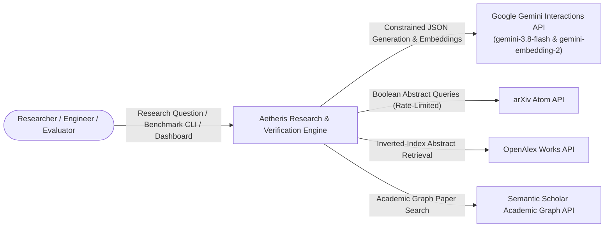
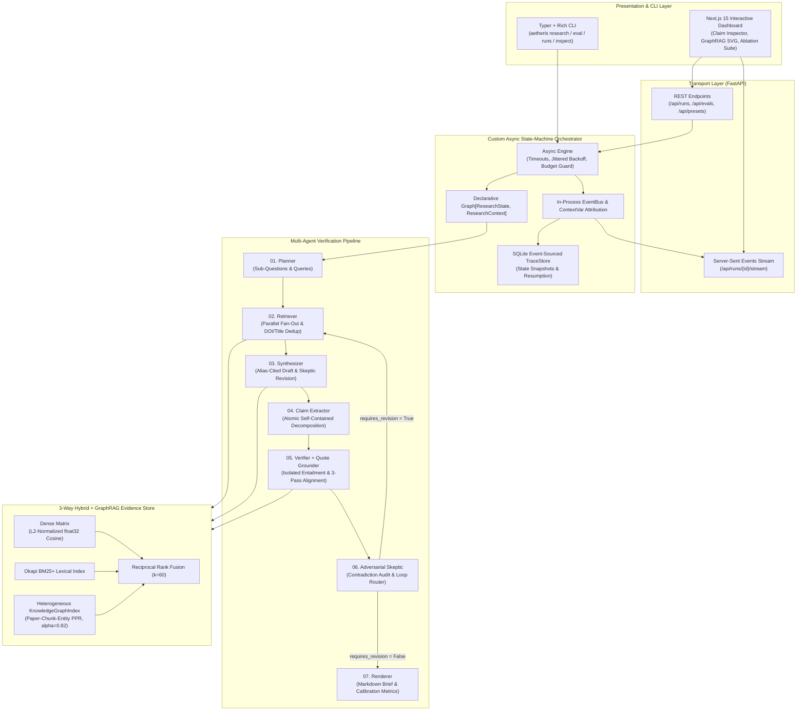

# Aetheris System Architecture

This document specifies the C4 architecture, state-machine invariants, hybrid GraphRAG indexing model, and mechanical quote-grounding guarantees of **Aetheris**.

---

## 1. System Context (C4 Level 1)

---

## 2. Container & Component Architecture (C4 Level 2 & 3)

---

## 3. State-Machine & Fault-Tolerance Invariants

Unlike opaque framework wrappers, `aetheris/orchestrator/` implements a small, formally verified state machine (`Graph[S, C]` and `Engine`):

1. **Static Pre-Flight Graph Validation (`Graph.validate`)**:
   Before any node executes, the graph verifies:
   - Entry node existence;
   - Every node has exactly one outgoing transition (static edge or conditional router);
   - Every target node exists (or is the terminal sentinel `__end__`);
   - Every registered node is reachable from `entry` via BFS;
   - At least one node transitions to `__end__` (no inescapable cycles).
2. **Atomic State Transitions**:
   A node receives an immutable Pydantic `ResearchState` and returns a new `ResearchState`. If a node raises an exception, partial mutations are discarded and the predecessor's state is preserved.
3. **Retry Policy with Exponential Backoff & Jitter**:
   `TransientError` (HTTP 408, 429, 500, 502, 503, 504) and `TimeoutError` trigger per-node retries with delay:
   $$d(a) = \min\left(d_{\max},\; d_0 \cdot m^{a-1}\right) \cdot (1 + \mathcal{U}(-j, j))$$
4. **Hard Resource Budgets (`Budget`)**:
   Every LLM call checks and charges `max_llm_calls`, `max_total_tokens`, and `max_seconds`. Crossing any threshold raises `BudgetExceededError` and transitions the run cleanly to `RunStatus.BUDGET_EXCEEDED` while preserving the latest valid state in SQLite.
5. **Deterministic Resumption (`TraceStore.load_snapshot`)**:
   Every `NODE_COMPLETED` event persists a JSON snapshot of `ResearchState`. Any interrupted run can be resumed from any node via `Engine.run(..., start_at=node_name)`.

---

## 4. Three-Pass Mechanical Quote Grounding (`agents/grounding.py`)

Post-hoc LLM verifiers frequently "support" claims by generating plausible paraphrases that do not actually appear in the source abstract. Aetheris enforces a strict mechanical contract:

1. **Pass 1 — Exact Substring (`exact`)**:
   Checks whether the verifier's quote $q$ occurs verbatim in chunk text $T$, returning exact paper character offsets $[\text{chunk.char\_start} + s,\; \text{chunk.char\_start} + e)$.
2. **Pass 2 — Typography & Whitespace Normalized (`normalized`)**:
   Maps curly quotes (`“”‘’`), em/en-dashes (`—–`), minus signs (`−`), case, and runs of whitespace to canonical ASCII while maintaining a character-by-character inverse index map $M: \{0, \dots, |T'|-1\} \to \{0, \dots, |T|-1\}$ back to the original abstract offsets.
3. **Pass 3 — Bounded Difflib Alignment (`fuzzy`)**:
   Computes contiguous matching blocks between normalized $q'$ and $T'$ using `SequenceMatcher(autojunk=False)`. Accepts the span only if character coverage $\ge 0.90$ within a window of length $\le 1.25 |q'|$, tolerating minor hyphenation or punctuation differences while rejecting paraphrases.

If a verifier outputs `SUPPORTED` or `REFUTED` and **none** of its quotes pass any of the 3 passes, the verdict is mechanically downgraded to `NOT_ENOUGH_INFO` with `grounding_failed = True`.
